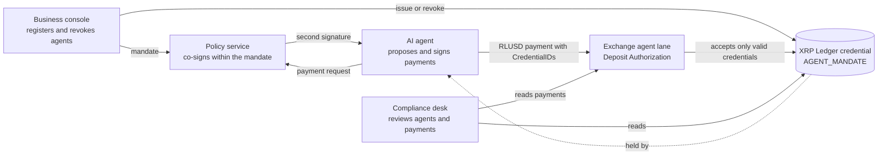

# Tšepo

Identity and authority for AI agents that pay, recorded on the XRP Ledger.

Built for the Node Engine Hackathon 2026, Agentic Finance track.

**Live demo:** https://app-production-9a4c0995.up.railway.app

It runs on the XRP Ledger Testnet with test funds only. Every screen opens
without sign-up. Live steps, such as the 3-minute tour, need the access
code given in the submission.

## The problem

AI agents can now hold a wallet and send money. The party that receives
the money cannot tell who the agent works for, what it is allowed to pay,
or whether that permission still stands. A business that gives an agent a
key gives it full control of the account, with no limit and no way to
withdraw the authority short of moving the funds. Exchanges and other
receivers either accept every agent payment or refuse them all.

## How it works

1. **Register.** A business registers its agent in the business console
   with a mandate: who the agent works for, the approved recipients, a
   limit per payment, a daily limit, and an expiry date.
2. **Record.** The Tšepo issuer records the mandate on the XRP Ledger as
   an `AGENT_MANDATE` credential held by the agent account. The credential
   carries only a fingerprint of the mandate. Personal data never goes on
   the ledger.
3. **Pay.** The agent pays in RLUSD on its own. Its account requires two
   signatures: the agent key and the key of an independent policy service.
   The policy service checks each payment against the mandate and signs
   only when the payment is within it.
4. **Receive.** An exchange runs an agent lane deposit account. Through
   credential-based Deposit Authorization, the ledger itself rejects any
   payment to that account from a sender without a valid
   `AGENT_MANDATE` credential.
5. **Revoke.** The business can revoke the agent at once. The issuer
   deletes the credential, and the agent lane rejects the next payment.
6. **Review.** A compliance desk reads the credential, the mandate
   fingerprint and the tagged payment history to see which agent paid,
   for whom, and under which mandate.

Every agent payment carries a `SourceTag` (default `20260530`) so that
agent activity can be told apart from human activity on the ledger.

## Integrate as an exchange

The Integrate page in the Receiving exchange workspace shows the three
steps an exchange takes. Its code comes from a script that runs every step
on the XRP Ledger Testnet, so the page and the script never differ.

Try it yourself: `npm run example:integration`

It needs no keys of yours and no access code. It creates a test exchange
account from the Testnet faucet, turns on credential-based Deposit
Authorization, proves that a sender without a credential is rejected,
checks two agents' credentials and matches a real payment to its Travel
Rule details. The output looks like this, with different addresses and
hashes on every run:

```text
Tšepo exchange integration on the XRP Ledger Testnet

Step 0. Create a test exchange account
  funded rBwftNZXYXeUZm41E7dWwthf7nPzdDoi5Z from the Testnet faucet

Step 1. Turn on credential-based Deposit Authorization
  submitting AccountSet 6BEB0D24...0A69B4
  tesSUCCESS
  submitting DepositPreauth 19D47B89...3F57A1
  tesSUCCESS
  Check: an account without a Tšepo credential pays 1 XRP to the deposit address
  submitting Payment 281057EC...58831C
  rejected with tecNO_PERMISSION, as expected

Step 2. Check an agent’s Tšepo credential
  rMQqusFUcxkKhbETdS7nMF4ELhJ9QciiPp: Verified. Rules fingerprint sha256:7506c19b...179b52
  rwAppV9jGbEv5tfmp1Tz1629uzrF5E77a6: Not verified, no Tšepo credential

Step 3. Match the Travel Rule details by fingerprint
  payment F862AD64...786800: matched. The InvoiceID is the fingerprint of the details, and the sender, the deposit address and the rules agree.

Done. Every step passed.
```

The script is [examples/exchange-integration.ts](examples/exchange-integration.ts).
It makes its keys in memory, prints only addresses, hashes and results, and
stops at any result other than `tesSUCCESS`.

## Architecture



## Status

Deployed on Railway as two services in one project, on the XRP Ledger
Testnet. Every screen, the guided tour and the exchange integration work
end to end.

| Part | Where | Job |
|---|---|---|
| Domain rules | `src/domain` | Pure, tested functions: mandate, decision rules, Directive 9 package, fingerprints, deposit assessment |
| Policy service | `src/policy` | Own key and append-only log; reads the credential from the ledger before every signature; signs or refuses with reason codes |
| Registry | `src/registry` | Registers an agent (signer list, master key disabled, credential), re-issues the credential when limits change, revokes |
| Agent | `src/agent` | Reads a plain-language payout list with Claude, sends the Directive 9 package to the exchange first, then pays with the policy co-signature |
| Exchange verifier | `src/exchange` | Stores packages, watches the agent lane, records each deposit as Cleared or Held, reads refused attempts from the policy log |
| Storage | `src/storage` | A small interface with a local file adapter (`.data/`) |

## Deployment

The project runs on Railway, deployed with the Railway CLI (`railway up`),
as two services:

| Service | Holds | Reached |
|---|---|---|
| `app` | The web app, the agent and the exchange, with every seed except the policy key | Public domain, HTTPS |
| `policy` | The approval service: only `POLICY_SEED`, the issuer's address and a shared token | Railway's private network only, with no public domain |

- Each service keeps its records on its own persistent volume at `/data`
  (`TSEPO_DATA_DIR=/data`).
- The app reaches the policy service at `POLICY_SERVICE_URL` with a bearer
  token. With that variable set, the app refuses to start if it holds
  `POLICY_SEED`, so a compromised app can never co-sign. The agent key has
  weight 1 and the quorum is 2, which the ledger enforces, so a compromised
  policy service cannot pay alone either.
- The policy service starts with `npm run policy:serve`, answers only
  `/health` without the token, and checks every request body with Zod.
- Every response carries a content security policy, HSTS and the other
  standard security headers. The build fails if any secret value reaches
  the files a browser downloads.
- On your own machine, leave `POLICY_SERVICE_URL` empty: the app then runs
  the policy service in-process with `POLICY_SEED`, as before.

After a first deploy to fresh volumes, run Restore once (the guided tour,
last step, "Restore sample data") so the policy service records the sample
spending rules.

## Running the demo

1. `npm run spike:accounts` creates and funds the Testnet accounts and
   writes their seeds to `.env.local`.
2. Fund the agent with Testnet RLUSD (see the Phase 1 notes), and add
   `ANTHROPIC_API_KEY` to `.env.local`.
3. Run `npm run demo:reset` before each scenario. It returns all RLUSD to
   the agent, applies the business-signed mandate (3 RLUSD per payment,
   5 RLUSD per day), re-issues the credential if needed, and clears the
   daily totals.
4. Run a scenario:
   - `npm run scenario:1`: an unknown agent is refused by the policy
     service and rejected by the ledger.
   - `npm run scenario:2`: a verified agent pays 2 RLUSD; the exchange
     clears it.
   - `npm run scenario:3`: three split payments of 2 RLUSD; the third is
     refused.
   - `npm run scenario:4`: the business revokes the agent; its next payment
     is refused.

## Development

Requirements: Node 24 and npm.

```sh
npm install
npm run check
```

End-to-end tests drive the running app against Testnet: start it with
`npm run build && npm start`, then run `npm run test:e2e`. The public page
checks (`npm run test:site`) use the same running build and touch nothing on
the ledger.

Copy `.env.example` to `.env.local` and fill in the values there.
`.env.local` is gitignored and is the only place seeds are kept. This
project runs on the XRP Ledger Testnet only.

See [AGENTS.md](AGENTS.md) for the rules every contributor follows.

## Credits

- Interface components from [Untitled UI React](https://www.untitledui.com/react)
  (MIT licence), built on React Aria (Apache 2.0 licence). The copied files are
  in `ui/`, with our changes listed in `ui/README.md` and our theme in
  `ui/styles/tsepo-theme.css`.
- Icons from Untitled UI (MIT licence).
- IBM Plex Sans and IBM Plex Mono (SIL Open Font Licence).
