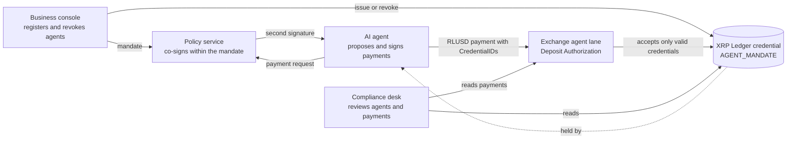

# Tšepo

Identity and authority for AI agents that pay, recorded on the XRP Ledger.

Built for the Node Engine Hackathon 2026, Agentic Finance track.

## The problem

AI agents can now hold a wallet and send money. The party that receives
the money cannot tell who the agent works for, what it is allowed to pay,
or whether that permission still stands. A business that gives an agent a
key gives it full control of the account, with no limit and no way to
withdraw the authority short of moving the funds. Exchanges and other
receivers either accept every agent payment or refuse them all.

## How it works

1. **Register.** A business registers its agent in the business console
   with a mandate: who the agent works for, the approved recipients, a
   limit per payment, a daily limit, and an expiry date.
2. **Record.** The Tšepo issuer records the mandate on the XRP Ledger as
   an `AGENT_MANDATE` credential held by the agent account. The credential
   carries only a fingerprint of the mandate. Personal data never goes on
   the ledger.
3. **Pay.** The agent pays in RLUSD on its own. Its account requires two
   signatures: the agent key and the key of an independent policy service.
   The policy service checks each payment against the mandate and signs
   only when the payment is within it.
4. **Receive.** An exchange runs an agent lane deposit account. Through
   credential-based Deposit Authorization, the ledger itself rejects any
   payment to that account from a sender without a valid
   `AGENT_MANDATE` credential.
5. **Revoke.** The business can revoke the agent at once. The issuer
   deletes the credential, and the agent lane rejects the next payment.
6. **Review.** A compliance desk reads the credential, the mandate
   fingerprint and the tagged payment history to see which agent paid,
   for whom, and under which mandate.

Every agent payment carries a `SourceTag` (default `20260530`) so that
agent activity can be told apart from human activity on the ledger.

## Architecture



## Status

Phase 2: the core engine runs end to end from scripts. There is no
interface yet.

| Part | Where | Job |
|---|---|---|
| Domain rules | `src/domain` | Pure, tested functions: mandate, decision rules, Directive 9 package, fingerprints, deposit assessment |
| Policy service | `src/policy` | Own key and append-only log; reads the credential from the ledger before every signature; signs or refuses with reason codes |
| Registry | `src/registry` | Registers an agent (signer list, master key disabled, credential), re-issues the credential when limits change, revokes |
| Agent | `src/agent` | Reads a plain-language payout list with Claude, sends the Directive 9 package to the exchange first, then pays with the policy co-signature |
| Exchange verifier | `src/exchange` | Stores packages, watches the agent lane, records each deposit as Cleared or Held, reads refused attempts from the policy log |
| Storage | `src/storage` | A small interface with a local file adapter (`.data/`) |

## Running the demo

1. `npm run spike:accounts` creates and funds the Testnet accounts and
   writes their seeds to `.env.local`.
2. Fund the agent with Testnet RLUSD (see the Phase 1 notes), and add
   `ANTHROPIC_API_KEY` to `.env.local`.
3. Run `npm run demo:reset` before each scenario. It returns all RLUSD to
   the agent, applies the business-signed mandate (3 RLUSD per payment,
   5 RLUSD per day), re-issues the credential if needed, and clears the
   daily totals.
4. Run a scenario:
   - `npm run scenario:1`: an unknown agent is refused by the policy
     service and rejected by the ledger.
   - `npm run scenario:2`: a verified agent pays 2 RLUSD; the exchange
     clears it.
   - `npm run scenario:3`: three split payments of 2 RLUSD; the third is
     refused.
   - `npm run scenario:4`: the business revokes the agent; its next payment
     is refused.

## Development

Requirements: Node 24 and npm.

```sh
npm install
npm run typecheck
npm test
```

Copy `.env.example` to `.env.local` and fill in the values there.
`.env.local` is gitignored and is the only place seeds are kept. This
project runs on the XRP Ledger Testnet only.

See [AGENTS.md](AGENTS.md) for the rules every contributor follows.

## Credits

- Interface components from [Untitled UI React](https://www.untitledui.com/react)
  (MIT licence), built on React Aria (Apache 2.0 licence). The copied files are
  in `ui/`, with our changes listed in `ui/README.md` and our theme in
  `ui/styles/tsepo-theme.css`.
- Icons from Untitled UI (MIT licence).
- IBM Plex Sans and IBM Plex Mono (SIL Open Font Licence).
